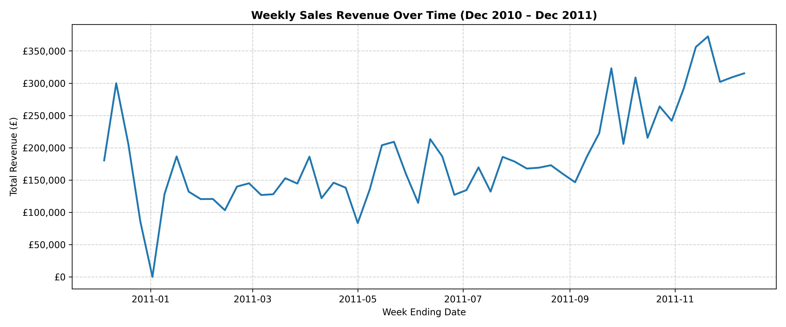
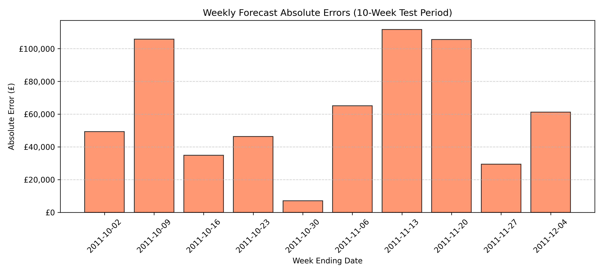

# E-Commerce Sales Forecasting & Revenue Analysis

This project evaluates whether historical sales data and weekly order patterns can reliably forecast future weekly revenue for an online retailer.

---

## Problem Statement

The goal of this project is to determine whether past revenue and order counts can predict future weekly sales more accurately than a simple baseline forecast.

Accurate forecasts help businesses plan budgets, resources, and inventory. This project tests whether one year of past sales data can predict future revenue.

---

## Data

The dataset contains 541,909 transactions from a UK-based online retailer between December 2010 and December 2011, sourced from Kaggle and originally from the UCI Machine Learning Repository.

Key data preparation steps included:
* Removing non-product administrative charges and handling missing item descriptions.
* Standardizing country names (e.g., converting RSA to South Africa and EIRE to Ireland).
* Identifying and removing canceled transactions, including large cancellations of £77k and £168k, by comparing transaction quantities.
* Aggregating individual transactions into weekly revenue totals and weekly order counts.
* Identifying a week of £0 revenue in early January as an annual holiday closure rather than missing data, and using linear interpolation to resolve it.


*Figure 1: Weekly sales over time showing steady revenue for most of the year, followed by a sharp increase in November.*


*Figure 2: The top 10 products by total sales, led by the Regency Cakestand 3 Tier generating over £175,000.*

---

## Methodology

The data was split by date, using the first 39 weeks for training and the final 10 weeks for testing so the models only learn from past data.

Four features were created from past sales:
* Previous week revenue
* Revenue from two weeks earlier
* Previous week order count
* A 4-week rolling average of revenue

Calendar features (week of the year and holiday indicator) were also tested but removed because one year of data was not enough to learn reliable seasonal patterns.

I evaluated several models:
* **Naive Baseline:** Uses the previous week's sales directly as the forecast.
* **Mean Benchmarks:** Compares predictions against the average weekly revenue.
* **Linear and Ridge Regression:** Tests straight-line relationships between past sales and future sales.
* **Random Forest:** Tests tree-based settings (limiting tree depth to 3 and minimum samples per leaf to 2) to avoid memorizing the small 39-week training set.
* **Blended Model:** Combines 35% of the Naive Baseline prediction with 65% of the Random Forest prediction.

---

## Results

Models were evaluated using Mean Absolute Error (MAE), Root Mean Squared Error (RMSE), and R^2:

| Model | Features | MAE | RMSE | R^2 |
| :--- | :--- | :--- | :--- | :--- |
| **Naive Baseline** | Prior Week | £59,202.27 | £69,075.38 | -0.7327 |
| **Linear Regression** | Baseline | £61,802.95 | £71,983.25 | -0.8816 |
| **Ridge Regression** | Baseline | £61,802.99 | £71,983.28 | -0.8816 |
| **Linear Regression** | Baseline + Calendar | £109,747.60 | £125,209.22 | -4.6930 |
| **Ridge Regression** | Baseline + Calendar | £109,727.63 | £125,183.77 | -4.6907 |
| **Final Blend (35% Naive + 65% RF)** | Baseline | £55,670.16 | £63,582.15 | -0.4680 |

The blended model performed best among the trained models, reducing the MAE from £59,202 to approximately £55,670.


*Figure 3: Actual sales compared against the simple baseline and the 35/65 blended model across the 10-week test period.*


*Figure 4: The size of prediction errors each week, showing that over 60% of total error occurred during the three peak holiday weeks in November.*

All models had negative R^2 values. Most of the prediction error came from the final three weeks of November, when weekly revenue rose above £300,000 and reached £370,000. Because the training data only covered one year and did not include an earlier holiday season, the models could not anticipate these sales peaks.

---

## Limitations

* **Limited Data:** One year of data is not enough to learn annual sales patterns or predict holiday sales peaks reliably.
* **Holiday Sales:** The models perform better during normal sales periods than during sudden increases in holiday revenue.
* **Future Improvements:** Use multiple years of data, include promotional dates, and forecast sales by product category.

---

## How to Run This Project

1. **Clone the repository:**
   ```bash
   git clone [https://github.com/walji123/](https://github.com/walji123/)<your-repo-name>.git
   cd <your-repo-name>