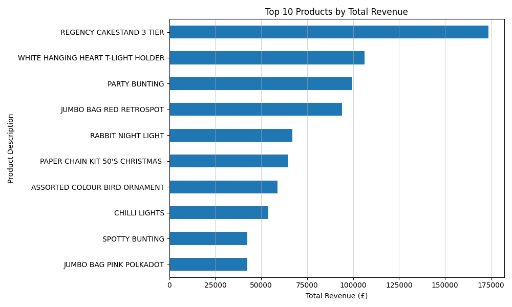
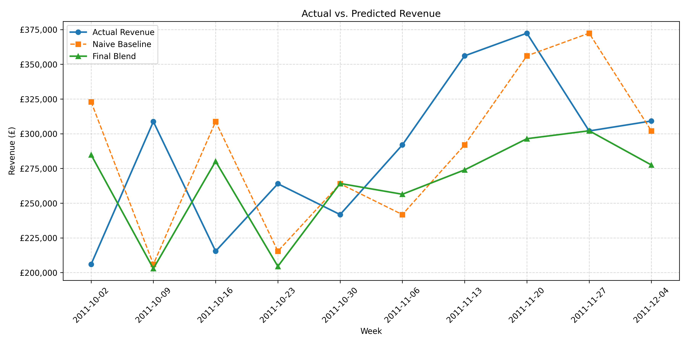

# E-Commerce Sales Forecasting & Revenue Analysis

This project evaluates whether historical sales data and weekly order patterns can reliably forecast future weekly revenue for an online retailer.

## Problem Statement

The goal of this project is to determine whether past revenue and order counts can predict future weekly sales more accurately than a simple baseline forecast. 

Accurate forecasts help businesses plan budgets, resources, and inventory. This project tests whether one year of past sales data can predict future revenue.

## Data

The dataset contains 541,909 transactions from a UK-based online retailer between December 2010 and December 2011, sourced from [Kaggle](https://www.kaggle.com/datasets/carrie1/ecommerce-data) and originally from the [UCI Machine Learning Repository](https://archive.ics.uci.edu/dataset/352/online+retail).

Key data preparation steps included:
- Removing non-product administrative charges and handling missing item descriptions.
- Standardizing country names (e.g., converting RSA to South Africa and EIRE to Ireland).
- Identifying and removing canceled transactions, including large cancellations of £77k and £168k, by comparing transaction quantities.
- Aggregating individual transactions into weekly revenue totals and weekly order counts.
- Identifying a week of £0 revenue in early January as an annual holiday closure rather than missing data, and using linear interpolation to resolve it.

## Methodology

The data was split chronologically, using the first 39 weeks for training and the final 10 weeks for evaluation.

Four core features were engineered from historical sales:
- Previous week revenue (Lag 1)
- Revenue from two weeks earlier (Lag 2)
- Previous week order count (Lag 1 Orders)
- A 4-week rolling average of revenue

Calendar features were also tested but removed because one year of data was not enough to learn reliable seasonal patterns.

I evaluated several model configurations:
- **Naive Baseline:** Predicting next week's revenue using the prior week's actual revenue.
- **Mean Benchmarks:** Comparing predictions against the historical training mean and the evaluation set mean.
- **Linear and Ridge Regression:** Testing linear relationships between past activity and sales.
- **Random Forest:** Testing constrained settings (depth 2 to 6, leaf samples) to prevent overfitting on the 39 training weeks.
- **Blended Model:** Combining 35% Naive baseline predictions with 65% Random Forest predictions.

## Results

Models were evaluated across Mean Absolute Error (MAE), Root Mean Squared Error (RMSE), and R^2:

| Model | Features | MAE | RMSE | R^2 |
| :--- | :--- | :--- | :--- | :--- |
| Naive Baseline | Prior Week | £59,202.27 | £69,075.38 | -0.7327 |
| Linear Regression | Baseline | £61,802.95 | £71,983.25 | -0.8816 |
| Ridge Regression | Baseline | £61,802.99 | £71,983.28 | -0.8816 |
| Linear Regression | Baseline + Calendar | £109,747.60 | £125,209.22 | -4.6930 |
| Ridge Regression | Baseline + Calendar | £109,727.63 | £125,183.77 | -4.6907 |
| **Final Blend (35% Naive + 65% RF)** | **Baseline** | **£55,670.16** | **£63,582.15** | **-0.4680** |

The blended model performed best among the trained models, reducing the MAE from £59,202 to approximately £55,645. 

All models had negative R^2 values. Over 80% of prediction error came from the final three weeks of November, when weekly revenue rose above £300,000 and reached £370,000. Since the training data did not include a previous holiday season, the models struggled to predict these sales peaks.

## Limitations

- **Limited Data**: One year of data is not enough to learn annual sales patterns or predict holiday sales peaks reliably.
- **Holiday Sales**: The models perform better during normal sales periods than during sudden increases in holiday revenue.
- **Future Improvements**: Use multiple years of data, include promotional dates, and forecast sales by product category.